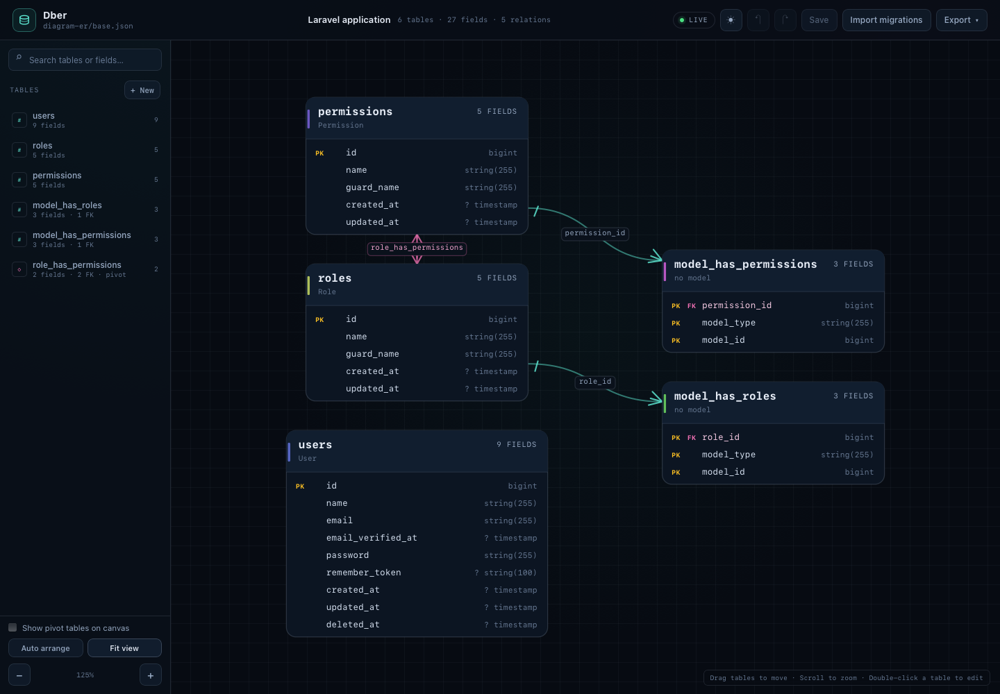
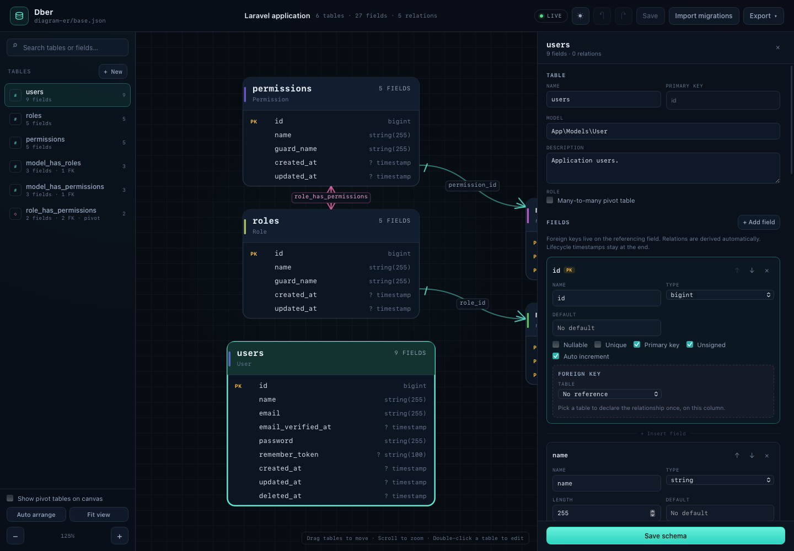
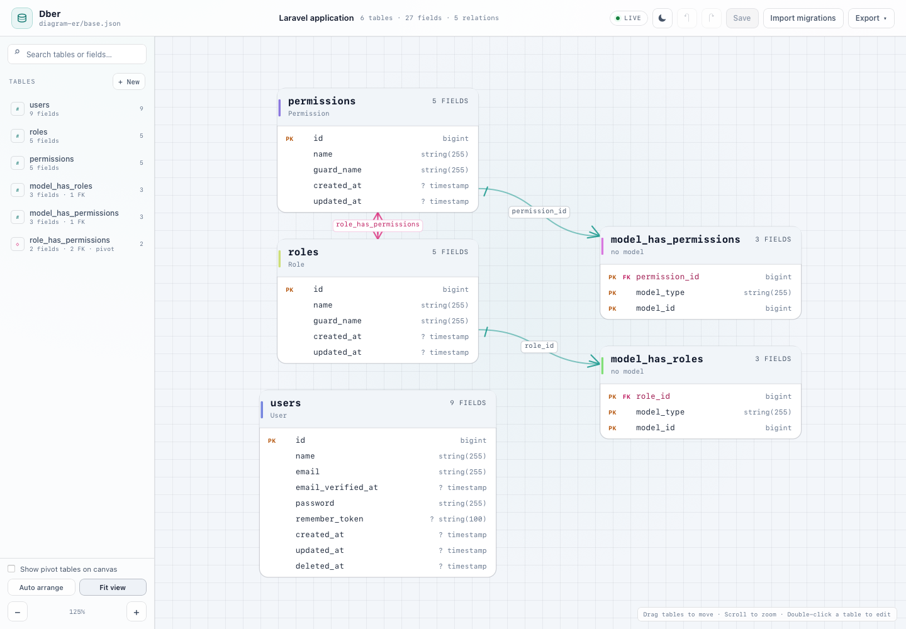

# Dber

Diagramas entidad-relación editables, versionables y legibles por agentes de IA para Laravel.

Dber convierte un archivo JSON (o YAML) en la única fuente de verdad del esquema.
El archivo se puede editar con el inspector visual, a mano o por un agente, y el
navegador muestra el diagrama actualizado en vivo. Las relaciones, la cardinalidad,
las claves primarias y las tablas pivote se derivan del propio esquema: no hay una
segunda lista de relaciones que se pueda desincronizar.



## Qué incluye

- **Un archivo de esquema versionable** en `diagram-er/base.json`, pensado para
  vivir en el repositorio del proyecto.
- **Preview en tiempo real** en `/dber`; si el archivo cambia desde el editor, un
  comando o un agente, el diagrama se recarga solo.
- **Editor visual** para crear tablas, campos, claves foráneas y tablas pivote.
  Guarda con `⌘S` y maneja conflictos si el archivo cambió en disco.
- **Tema oscuro y claro** con un botón en la barra superior; la preferencia se
  guarda en el navegador.
- **Inserción de campos entre filas existentes**, no solo al final.
- **Timestamps de ciclo de vida al final** (`created_at`, `updated_at`,
  `deleted_at`), y `deleted_at` incluido en las tablas nuevas.
- **Un clic en una tabla** abre el inspector lateral con su edición.
- **Relaciones gráficas** con cardinalidad: uno a muchos, uno a uno y muchos a
  muchos, incluyendo tablas pivote y auto-referencias.
- **Campos con tipo, longitud, precisión, valores enum, default, nullabilidad,
  unique, unsigned y auto-incremento**.
- **Contexto global para IA** generado desde el esquema, más `AGENTS.md` y un
  JSON Schema para que el agente sepa leer y actualizar el archivo.
- **Validación** con `php artisan dber:validate` y desde el endpoint de guardado.
- **Importar desde migraciones** con el botón “Import migrations” o
  `php artisan dber:import`, incluyendo alteraciones posteriores de tablas.
- **Exportación** a Markdown para IA, Mermaid y JSON canónico.
- **Cero dependencias de frontend**: SVG, CSS y JavaScript propios, sin npm, sin
  CDN y sin build step.

## Requisitos

- PHP 8.2+ (Laravel 13 requiere PHP 8.3+)
- Laravel 10, 11, 12 o 13
- JSON (incluido en PHP)
- YAML opcional: `symfony/yaml` 6.4–8.x

El paquete está pensado para instalarse como dependencia de desarrollo. Las
constraints son amplias a propósito: el código usa APIs estables de Laravel y no
depende de una versión concreta del framework.

## Instalación

```bash
composer require huzzidiel/dber --dev
php artisan dber:install
```

El comando publica:

```text
config/dber.php
diagram-er/base.json
diagram-er/schema.json
diagram-er/AGENTS.md
```

Después levanta la aplicación y visita:

```text
http://localhost:8000/dber
```

Para desarrollo local del paquete, antes de publicarlo, puedes usar un repositorio
de tipo `path`:

```json
{
    "repositories": [
        {
            "type": "path",
            "url": "../dber"
        }
    ]
}
```

Y luego:

```bash
composer require huzzidiel/dber:@dev --dev
```

## Configuración

El archivo `config/dber.php` se publica con:

```bash
php artisan vendor:publish --tag=dber-config
```

Variables principales:

| Variable | Default | Descripción |
| --- | --- | --- |
| `DBER_ENABLED` | `true` en `local` | Registra las rutas del visor. |
| `DBER_PATH` | `diagram-er/base.json` | Archivo fuente del esquema. |
| `DBER_EDITOR` | `true` | Permite guardar desde el navegador. |
| `DBER_ROUTE_PREFIX` | `dber` | Prefijo de las rutas. |
| `DBER_ROUTE_DOMAIN` | `null` | Dominio opcional. |
| `DBER_POLL_INTERVAL` | `1500` | Milisegundos entre comprobaciones del archivo. |
| `DBER_MAX_SIZE` | `2097152` | Tamaño máximo del archivo en bytes. |
| `DBER_MIGRATIONS_PATH` | `database/migrations` | Directorio que escanea `dber:import`. |

El middleware de las rutas se configura en `dber.route.middleware` y por defecto
es `web`. El prefijo y el dominio también se pueden cambiar desde el archivo de
configuración.

### Seguridad

Las rutas se registran solo en `local` por defecto. El endpoint de guardado escribe
en el sistema de archivos y no incluye autenticación propia. Si habilitas Dber
fuera de desarrollo, protégelo con middleware de autenticación/autorización:

```php
'middleware' => [
    'web',
    'auth',
],
```

También puedes desactivar el editor y dejar solo la vista:

```dotenv
DBER_EDITOR=false
```

## El archivo de esquema

`diagram-er/base.json` es la fuente de verdad. Un ejemplo mínimo:

```json
{
    "$schema": "./schema.json",
    "schema_version": 1,
    "name": "My application",
    "database": "mysql",
    "tables": {
        "users": {
            "model": "App\\Models\\User",
            "primary_key": ["id"],
            "fields": {
                "id": {
                    "type": "bigint",
                    "unsigned": true,
                    "auto_increment": true
                },
                "email": {
                    "type": "string",
                    "length": 255,
                    "unique": true
                }
            }
        },
        "orders": {
            "primary_key": ["id"],
            "fields": {
                "id": {
                    "type": "bigint",
                    "unsigned": true,
                    "auto_increment": true
                },
                "user_id": {
                    "type": "bigint",
                    "unsigned": true,
                    "references": {
                        "table": "users",
                        "field": "id",
                        "on_delete": "restrict"
                    }
                },
                "total": {
                    "type": "decimal",
                    "precision": 12,
                    "scale": 2,
                    "default": 0
                }
            }
        }
    }
}
```

### Reglas globales

1. `tables` es un objeto indexado por el nombre físico de la tabla.
2. `fields` es un objeto indexado por el nombre físico de la columna.
3. `primary_key` es siempre un arreglo, incluso para claves compuestas.
4. Una clave foránea se declara **una sola vez**, en el campo que la contiene,
   dentro de `references`. La relación inversa se deriva automáticamente.
5. Una relación uno a uno es una clave foránea con `unique: true`.
6. Una relación muchos a muchos usa una tabla pivote con `"pivot": true`, al
   menos dos claves foráneas y una clave primaria compuesta.
7. `created_at`, `updated_at` y `deleted_at` son campos explícitos. No hay
   convenciones ocultas. Los tres se mantienen al final del listado de campos.
8. Las tablas nuevas creadas desde el visor incluyen `created_at`, `updated_at`
   y `deleted_at`. Las tablas de Spatie del ejemplo respetan sus migraciones
   originales (solo `created_at` y `updated_at`).
9. `description` es opcional y exclusivamente para humanos. No se usa para
   instrucciones de IA ni se genera automáticamente.
10. Los nombres de tablas y columnas usan `snake_case`.
11. Los índices compuestos se declaran en `indexes`; el editor visual los muestra
    y el JSON los conserva.

### Relaciones derivadas

Dber no guarda una lista paralela de relaciones. Las calcula así:

- `orders.user_id.references` apunta a `users.id` → `users` uno-a-muchos `orders`.
- Si el campo foráneo también es `unique` → uno-a-uno.
- Una tabla con `"pivot": true` y dos claves foráneas → muchos-a-muchos entre
  las dos tablas referenciadas, con la tabla pivote como puente.
- Una referencia de una tabla a sí misma dibuja una auto-relación.

Una tabla pivote puede tener columnas extra si el esquema las declara, pero la
relación directa muchos-a-muchos solo se deriva cuando hay exactamente dos claves
foráneas. Las claves foráneas de la tabla pivote siguen visibles cuando activas
"Show pivot tables on canvas".

### Ejemplo incluido: Spatie Permission

El instalador crea un esquema con:

- `users` (incluye `deleted_at` para soft deletes).
- `roles` y `permissions`, con `guard_name` y el índice único
  `name + guard_name`.
- `model_has_roles` y `model_has_permissions`, que son polimórficas: conservan
  `model_type` y `model_id`, pero `model_id` no se declara como FK porque puede
  apuntar a cualquier modelo.
- `role_has_permissions`, la tabla pivote muchos-a-muchos entre roles y permisos.

Las tablas de Spatie respetan sus migraciones originales: no incluyen
`deleted_at`. Las tablas nuevas creadas desde el visor sí lo incluyen por defecto.

### Tipos de campo

`bigint`, `integer`, `mediumint`, `smallint`, `tinyint`, `string`, `char`, `text`,
`mediumtext`, `longtext`, `boolean`, `decimal`, `float`, `double`, `date`,
`datetime`, `timestamp`, `time`, `year`, `json`, `uuid`, `ulid`, `binary`,
`enum`, `set`.

Propiedades por campo:

| Propiedad | Uso |
| --- | --- |
| `type` | Obligatorio. |
| `length` | `string`, `char`, `binary`. |
| `precision`, `scale` | `decimal`, `float`, `double`. |
| `nullable` | El campo acepta `NULL`. |
| `unique` | Restricción única. |
| `unsigned` | Tipos numéricos. |
| `auto_increment` | Enteros, normalmente la clave primaria. |
| `default` | Valor escalar. Omite la propiedad si no hay default. |
| `values` | Valores permitidos de `enum` y `set`. |
| `references` | `table`, `field`, `on_delete`, `on_update`. |

Acciones referenciales: `cascade`, `restrict`, `set_null`, `no_action`,
`set_default`.

### JSON Schema y YAML

`diagram-er/schema.json` describe el formato y permite autocompletado/validación
en editores como VS Code. El archivo fuente lo referencia con `"$schema"`.

JSON funciona sin instalar nada. Para usar YAML:

```bash
composer require symfony/yaml --dev
```

Configura `DBER_PATH=diagram-er/base.yml` y ejecuta `php artisan dber:install`.
El instalador convierte el ejemplo a YAML. También puedes renombrar el archivo y
editarlo a mano; Dber acepta `.json`, `.yaml` y `.yml`.

## Visor y editor

La ruta principal es `/dber` (configurable).

- **Sidebar**: busca por tabla, campo, tipo o tabla referenciada.
- **Canvas**: arrastra tablas, hace zoom con la rueda, panea con el fondo y hace
  clic en una tabla para abrir su inspector. "Fit view" y "Auto arrange"
  reordenan el diagrama.
- **Inspector**: edita la tabla, sus campos, la clave primaria, los flags y las
  claves foráneas. También muestra las relaciones derivadas y la zona de borrado.
- **Insert field**: entre cada par de campos aparece una línea con
  "+ Insert field" para crear un campo en esa posición. Los timestamps de ciclo
  de vida se mantienen al final.
- **Add relation**: crea la clave foránea o, para muchos-a-muchos, la tabla pivote.
- **Show pivot tables**: oculta o muestra las tablas pivote en el canvas. Con las
  pivote ocultas, el diagrama dibuja la relación muchos-a-muchos directa con
  línea punteada. Las pivote siguen disponibles en la barra lateral para
  editarlas.
- **Theme**: alterna entre tema oscuro y claro. La preferencia se guarda en
  `localStorage`.
- **Save**: escribe el archivo en disco y conserva el formato canónico. `⌘S` o
  `Ctrl+S` también guarda.
- **Undo/redo**: `⌘Z` / `⇧⌘Z` (fuera de un input) o los botones de la barra.
- **Export**: descarga el contexto de IA, el diagrama Mermaid o el JSON.





Las posiciones de las tablas se guardan en `localStorage` del navegador. No se
escriben dentro del archivo de esquema, para que el JSON siga siendo portable y
versionable.

### Guardado y conflictos

Cada carga incluye un hash del archivo. Antes de guardar se envía ese hash:

- Si el archivo no cambió, se escribe de forma atómica.
- Si cambió desde la carga, el servidor responde `409` y el navegador ofrece
  **Reload from disk** o **Overwrite file**.
- Si hay cambios locales sin guardar, el polling del archivo no los pisa: muestra
  el aviso de conflicto.
- El guardado nunca escribe un archivo inválido: si la validación falla, responde
  `422` con los errores y conserva el original.

## Importar desde migraciones

Dber puede construir el diagrama a partir de las migraciones existentes sin
ejecutarlas ni tocar la base de datos.

### Botón

En la barra superior del visor, pulsa **Import migrations**. Se abre un modal con
un resumen y la opción **Keep columns not found in migrations**. Al confirmar, el
documento se carga en el editor (sin guardar); revisa el resultado y pulsa
**Save**.

### Comando

```bash
php artisan dber:import
php artisan dber:import --dry-run
php artisan dber:import --keep-extra
php artisan dber:import --path=database/migrations
```

### Cómo funciona

1. Lee `database/migrations/*.php` ordenados por nombre.
2. Aplica en orden `Schema::create`, `Schema::table`, `Schema::drop` y
   `Schema::rename`, incluyendo:
   - agregar, renombrar y eliminar columnas;
   - tipos, longitudes, precisión, valores enum, `nullable`, `unsigned`,
     `default` y `autoIncrement`;
   - claves primarias, únicas e índices;
   - claves foráneas (`foreignId()->constrained()`, `foreign()->references()->on()`);
   - `timestamps`, `nullableTimestamps`, `softDeletes`, `rememberToken` y `morphs`.
3. Fusiona el resultado con el `base.json` actual:
   - conserva `model`, `description`, `name` y `database`;
   - elimina las columnas que las migraciones ya no declaran (salvo `--keep-extra`);
   - detecta tablas pivote (dos claves foráneas con clave primaria compuesta).
4. Valida el esquema resultante con las mismas reglas del guardado.

El endpoint `POST /dber/import` devuelve el documento generado, un resumen y las
advertencias.

### Limitaciones

- Es un parser estático: las construcciones dinámicas (variables, bucles,
  condicionales) se marcan como advertencia y se omiten.
- Las claves foráneas compuestas y algunos índices con nombre no se mapean; se
  informan como advertencias.
- No ejecuta SQL; interpreta el DSL estándar de Laravel.

## Uso con agentes de IA

El paquete está diseñado para que un agente entienda el esquema sin documentación
tabla por tabla dentro del JSON.

### `diagram-er/AGENTS.md`

El instalador publica una guía global con:

- propósito del archivo y reglas de edición;
- cómo declarar claves primarias, foráneas y pivotes;
- tipos y propiedades;
- ejemplos de cada operación;
- qué hacer cuando una relación no se puede representar (por ejemplo, polimórfica).

Indica a tu agente que lea ese archivo antes de tocar el esquema. Por ejemplo:

```text
Lee diagram-er/AGENTS.md y diagram-er/base.json.
Agrega una tabla subscriptions con relación a users, un plan enum y timestamps.
Después ejecuta php artisan dber:validate.
```

### Contexto generado

```bash
php artisan dber:export context
php artisan dber:export context --path=diagram-er/CONTEXT.md
```

El Markdown resultante contiene estadísticas, tablas, campos, tipos, defaults,
referencias, relaciones derivadas y la guía global de lectura. No se guarda dentro
del JSON ni se mantiene a mano: siempre se genera desde el archivo.

También está disponible en `GET /dber/context.md`.

### Flujo recomendado

1. El agente lee `diagram-er/AGENTS.md` y `diagram-er/base.json`.
2. Modifica solo `base.json` (o el archivo configurado).
3. Ejecuta `php artisan dber:validate`.
4. Si hay errores, corrige el JSON.
5. El humano abre `/dber` y ve el resultado en vivo.

El archivo `schema.json` sirve como contrato de formato para el editor y para el
agente. Los comentarios y descripciones por tabla no son necesarios para que el
agente entienda la estructura; las relaciones y claves están en el propio esquema.

## Endpoints

Todas las rutas usan el prefijo configurado (`dber` por defecto).

| Método | Ruta | Uso |
| --- | --- | --- |
| `GET` | `/dber` | Visor/editor. |
| `GET` | `/dber/data` | Documento normalizado, relaciones, issues, hash y estadísticas. |
| `PUT` | `/dber/data` | Guarda `{ document, hash, force? }`. |
| `POST` | `/dber/import` | Genera el documento desde las migraciones. |
| `GET` | `/dber/context.md` | Contexto Markdown para IA. |
| `GET` | `/dber/diagram.mmd` | Diagrama Mermaid. |
| `GET` | `/dber/schema.json` | JSON Schema publicado o el del paquete. |
| `GET` | `/dber/assets/{path}` | JS/CSS/favicon del paquete. |

Respuesta de éxito:

```json
{
    "status": "success",
    "message": "Schema loaded.",
    "data": {}
}
```

Respuesta de error:

```json
{
    "status": "error",
    "message": "The schema is invalid.",
    "errors": [
        {
            "severity": "error",
            "path": "tables.orders.fields.user_id.references.table",
            "message": "Referenced table \"users\" does not exist."
        }
    ]
}
```

El cliente envía el token CSRF en `X-CSRF-TOKEN` cuando las rutas usan `web`.

## Comandos

```bash
php artisan dber:install
php artisan dber:install --force
php artisan dber:validate
php artisan dber:export context
php artisan dber:export mermaid
php artisan dber:export json
php artisan dber:export context --path=diagram-er/CONTEXT.md
php artisan dber:import
php artisan dber:import --dry-run
```

`dber:validate` devuelve código de salida distinto de cero si hay errores. Las
advertencias no bloquean el guardado, pero suelen indicar un error de diseño.

## Producción

Dber es una herramienta de desarrollo. Antes de desplegar:

- Mantén `DBER_ENABLED=false` en producción, o protege `dber.route.middleware`
  con autenticación y autorización.
- Verifica que `diagram-er/base.json` esté versionado y que `dber:validate` pase
  en CI.
- Si usas YAML, instala `symfony/yaml` en el entorno donde se ejecute el comando o
  la aplicación.
- Asegura permisos de escritura para el archivo solo si el editor estará activo.
- Recuerda que las exportaciones leen el archivo en disco: guarda antes de
  exportar.
- No necesitas compilar assets ni publicar JS/CSS; se sirven desde el paquete.
- Si cacheas configuración, limpia la caché después de cambiar variables `DBER_*`.

## Arquitectura

```text
src/
├── Console/           # install, validate, export
├── Data/              # DTOs tipados: Diagram, Table, Field, Relation...
├── Exceptions/        # archivo inválido, conflicto de hash
├── Http/Controllers/  # visor, datos, assets
├── Support/           # normalizador, validador, repositorio, importador, exporters
└── DberServiceProvider.php
config/dber.php
routes/web.php
resources/
├── css/dber.css
├── js/                # módulos ES sin build
├── stubs/             # base.json, schema.json, AGENTS.md, favicon
└── views/diagram.blade.php
```

Flujo del backend:

1. `DiagramRepository` lee el archivo y valida el tamaño.
2. `DiagramNormalizer` normaliza tipos, defaults y claves.
3. `DiagramValidator` comprueba tipos, referencias, claves y pivotes.
4. `Diagram::fromArray()` construye DTOs tipados.
5. `RelationResolver` deriva las relaciones.
6. El controlador responde con el documento normalizado y los issues.

El navegador aplica las mismas reglas de derivación en JavaScript para que el
editor responda sin ida y vuelta al servidor. El servidor sigue siendo la
autoridad al guardar.

### Extender el paquete

- **Nuevo tipo de campo**: agrega el tipo en `TypeRegistry`, en `TYPES` de
  `resources/js/derive.js` y en `resources/stubs/schema.json`.
- **Nuevo exportador**: crea una clase en `src/Support`, inyéctala en el
  controlador y añade una ruta o un formato al comando.
- **Nueva validación**: añade la regla en `DiagramValidator` y, si es bloqueante,
  replica el mensaje en `resources/js/derive.js`.
- **Layout o estilo**: los módulos de `resources/js` y `resources/css` se sirven
  directamente; no hay build que regenerar.

## Limitaciones conocidas

- Las relaciones polimórficas (`morphTo`, `morphMany`) no se representan todavía
  con claves foráneas reales. La guía para agentes indica consultar al humano en
  ese caso.
- Los índices compuestos se editan en el JSON; el inspector los muestra y
  conserva, pero no tiene un formulario dedicado.
- Dber no introspecciona la base de datos ni genera migraciones. El archivo es la
  fuente de verdad elegida por el proyecto; no pretende adivinar el esquema real.
- El editor visual no implementa autenticación por sí mismo.
- YAML requiere `symfony/yaml`; JSON no requiere ninguna dependencia extra.

## Testing

```bash
composer test
```

Las pruebas cubren:
- lectura y normalización del esquema;
- relaciones uno-a-uno, uno-a-muchos, muchos-a-muchos y auto-referencias;
- validación de tipos, claves y referencias;
- guardado, conflictos de hash y `force`;
- endpoints del visor, contexto, Mermaid, assets y JSON Schema;
- comandos de instalación, validación y exportación;
- importación desde migraciones (create, alter, rename, drop, FKs y pivotes).

La suite se ejecutó contra Laravel 12 (Testbench 10, Pest 3) y Laravel 13
(Testbench 11, Pest 4). El entorno local queda en Laravel 13; las constraints del
paquete permiten Laravel 10–13 y Laravel 13 exige PHP 8.3+.

## Licencia

MIT. Consulta [LICENSE.md](LICENSE.md).
